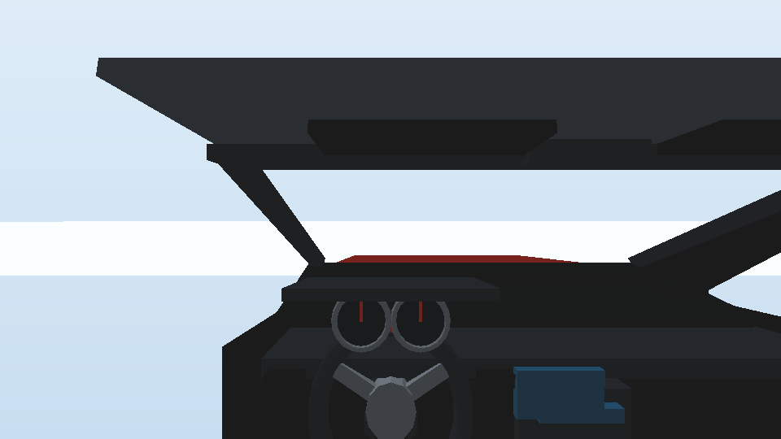
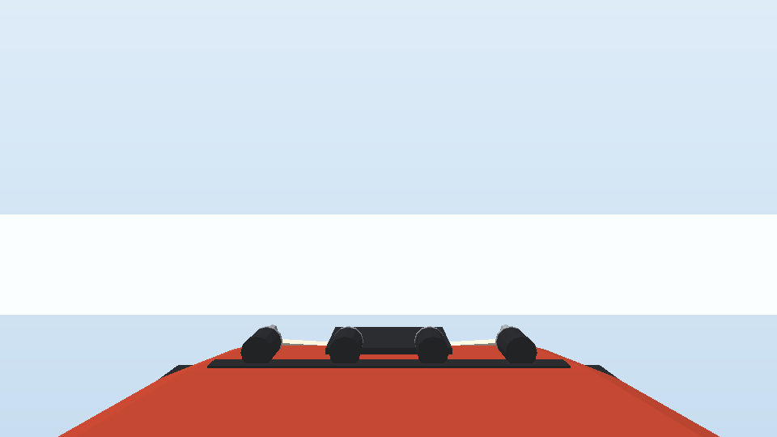

# Snowline Rally

单文件第三人称拉力游戏（three.js r180 + WebGL2），MIT 许可。

地形、赛道、车模、座舱、音效全部在运行时程序化生成 —— 没有外部图片、模型、字体或音频文件。
整个游戏打包成一个可直接双击打开的 HTML（953 KB），同一份文件被 ArkWeb 壳加载，打包成鸿蒙（HarmonyOS）应用。

**在线试玩**：https://salixqwq.github.io/SnowlineRally/refer/html/snowline-rally.html




## 特性

- 三条程序化赛道：雪线（3.45 km）、黄昏湾（3.35 km）、雾谷（3.60 km），带弯道路书与最佳成绩
- 街机手感：抓地/漂移、手刹、自动换挡、路面积雪反馈
- 键盘、触屏、手柄、手机重力转向四种输入；座舱 / 引擎盖 / 追尾三种视角；低/中/高三档画质
- 鸿蒙侧：ArkTS 读取加速度计，经 JS 桥把归一化转向值注入页面；横屏、全屏、渲染进程回收均有处理

## 快速开始

直接用浏览器打开 `refer/html/snowline-rally.html` 即可（`file://` 下重力转向不可用，其余功能正常）。
想要安全上下文（`DeviceMotionEvent` / 屏幕方向锁）：

```bash
cd dev
npm ci
npm run serve      # http://127.0.0.1:8123/
```

## 操作

| 操作 | 键盘 | 手柄 | 触屏 |
|---|---|---|---|
| 转向 | A / D 或 ← / → | 左摇杆 | 左侧拖动 |
| 油门 / 刹车 | W / S 或 ↑ / ↓ | RT / LT | 右下按键 |
| 手刹 | Space / Shift | A | 手刹键 |
| 暂停 / 重置 | P 或 Esc / R | Start | 暂停键 |
| 切换视角 / 静音 | C / M | Y | 设置面板 |

## 目录

| 路径 | 说明 |
|---|---|
| `refer/html/snowline-rally.html` | **交付物**：单文件游戏（953 KB，内联 three.js / CSS / 游戏逻辑） |
| `refer/html/sensor-test.html` | 重力传感器自检页（调试用，不参与打包） |
| `refer/html/preview-*.png` | 座舱 / 引擎盖视角预览图（README 配图） |
| `refer/html/archive/` | 旧构建快照，本地留存，**不入库**（见 `.gitignore`） |
| `dev/src/` | 游戏源码（ES module，11 个模块：赛道、物理、渲染、HUD、输入、音频…… + 样式表） |
| `dev/build.mjs` | 构建脚本：esbuild 打包 three.js 与游戏逻辑，内联成单文件 HTML |
| `dev/tools/` | 离线工具：静态服务器、CPU 光栅预览、HUD 冒烟测试 |
| `app/` | 鸿蒙工程（ArkTS 壳 + ArkWeb 桥接 + 传感器） |
| `app/build-profile.template.json5` | 工程配置模板（不含任何签名信息，复制后使用） |
| `.githooks/pre-commit` | 提交前拦截签名物料与本机路径（见「开源说明」） |

## 构建

```bash
cd dev
npm ci
npm run build      # 输出 ../refer/html/snowline-rally.html
npm test           # 赛道生成 + 物理回归 + HUD 冒烟
```

构建是确定性的：同一份 `package-lock.json` 产出的 HTML 字节一致，CI 会校验产物与源码是否同步。
改完源码后，记得把产物同步到鸿蒙工程的 rawfile：

```bash
cp refer/html/snowline-rally.html app/entry/src/main/resources/rawfile/
```

（仓库里保留了两份当前产物：`refer/html/` 供直接分发与 GitHub Pages，`rawfile/` 供打包；
两份必须一致，CI 会检查。）

## 鸿蒙（DevEco / ArkWeb）集成

1. **准备工程配置**（仓库不提供带签名的 `build-profile.json5`）：

   ```bash
   cp app/build-profile.template.json5 app/build-profile.json5
   ```

   用 DevEco Studio 打开 `app/`，File → Project Structure → Signing Configs →
   勾选 **Automatically generate signature**，由 IDE 写入你自己的证书与口令。
   `app/build-profile.json5` 已在 `.gitignore` 中，**任何情况下都不要提交**。

2. **确认 rawfile**：`app/entry/src/main/resources/rawfile/snowline-rally.html` 已就位。

3. **ArkTS `Web` 组件**（`app/entry/src/main/ets/pages/Index.ets` 已实现）：

```ts
Web({ src: $rawfile('snowline-rally.html'), controller: this.controller })
  .javaScriptAccess(true)
  .domStorageAccess(true)      // 设置、最佳成绩需要 localStorage
  .fileAccess(false)
  .onlineImageAccess(false)
  .zoomAccess(false)
  .mediaPlayGestureAccess(true) // WebAudio 需要用户手势
```

4. **方向**：`module.json5` 的 ability 用 `auto_rotation_restricted`，页面里的
   `screen.orientation.lock()` 经 `RallyBridge` 映射到原生窗口方向（触屏设备生效，2in1 保持自由旋转）。

5. **重力转向**：ArkWeb 不保证暴露 `DeviceMotionEvent`。`Index.ets` 在 document start 注入桥脚本，
   把原生加速度计数据转成标准 `devicemotion` 事件；页面里的 `input.js` 也保留了直接注入钩子：

```ts
this.controller.runJavaScript(`window.__rallySetSteer && window.__rallySetSteer(${v})`);
// 不使用倾斜时： window.__rallyClearSteer && window.__rallyClearSteer()
```

6. **全屏**：`window.setWindowLayoutFullScreen(true)` + `setWindowSystemBarEnable([])`，避免状态栏压住 HUD。
7. **音频**：WebAudio 需用户手势后启动，游戏本身已有「开始拉力」按钮。
8. 桌面/平板：鼠标键盘、触屏、手柄均可；窗口尺寸变化会自适应。

## 未签名 HAP

Release 会附带 `SnowlineRally-v1.0.0-unsigned.hap`：它不包含任何签名材料，安装前需要用自己的开发者证书签名。
请勿安装来源不明的已签名 HAP。

## 开源说明

仓库只收录「源码 / 配置模板 / 文档 / 许可证」。以下内容一律不入库（规则见 `.gitignore`）：

| 类别 | 内容 |
|---|---|
| 签名 | `app/build-profile.json5`、`dev/certs/`、`*.pem` / `*.key` / `*.p12` / `*.p7b` 等 |
| 依赖 | `dev/node_modules/`、`app/oh_modules/` |
| 构建缓存 | `app/.hvigor/`、`app/entry/build/`、`.preview` / `.cxx` / `.test` |
| 安装包 | `*.hap`、`*.app` |
| 本机状态 | `.idea/`、`.bitfun/`、`local.properties` |
| 历史快照 / 本地工作稿 | `refer/html/archive/`、一次性调参脚本、本地工作稿（均不入库） |

克隆后建议启用提交钩子（每个克隆一次）：

```bash
git config core.hooksPath .githooks
```

它会扫描所有文本文件（含文档与 HTML），拒绝包含 `keyPassword` / `storePassword`、本机绝对路径、私钥、证书或旧包名（`com.example.*`）的提交；
GitHub Actions 里有一道内容相同的检查（`.github/workflows/guard.yml`）。

## 参与贡献

欢迎提 Issue 与 PR：机型适配、手感调参、赛道设计、性能问题都可以聊。

> 手感（抓地、漂移、刹车、转向）是我自己一点点试出来的，非专业调校，请轻喷 —— 也欢迎提改进建议。

本项目在开发过程中使用 **DeepSeek V4.1 Flash 1017** 协助（代码生成、调参与调试），欢迎提 Issue 提建议。

## 许可

MIT，见 [`LICENSE`](LICENSE)。产物顶部内含 SPDX 标识、完整 MIT 文本与 three.js r180 的第三方声明；
游戏内所有美术与音频均为程序化生成，不含第三方素材。

`app/entry/src/main/ets/entrybackupability/EntryBackupAbility.ets` 来自 DevEco 工程模板，
保留 Huawei 的 Apache-2.0 许可头；其余代码为 MIT。
